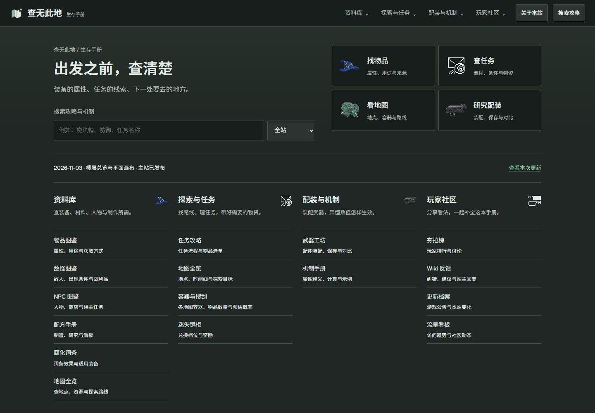
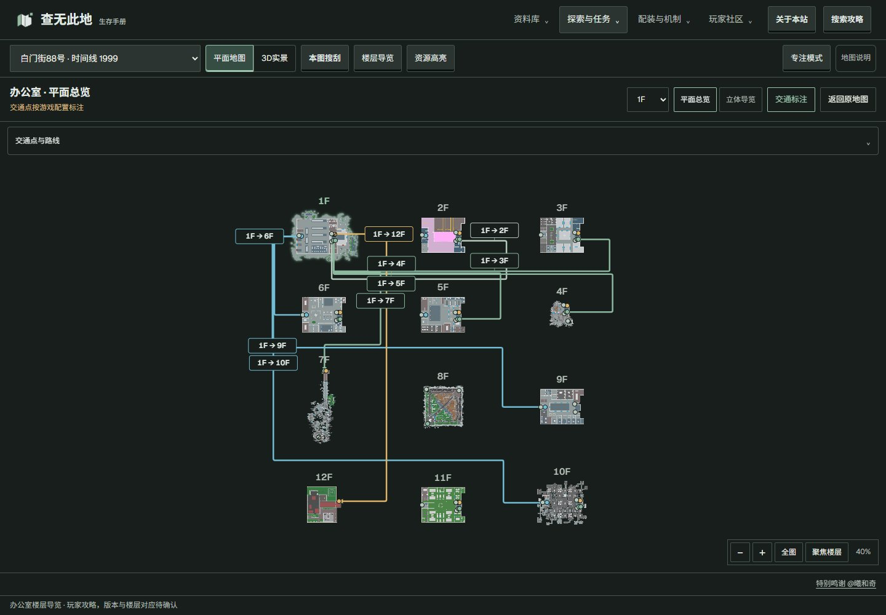
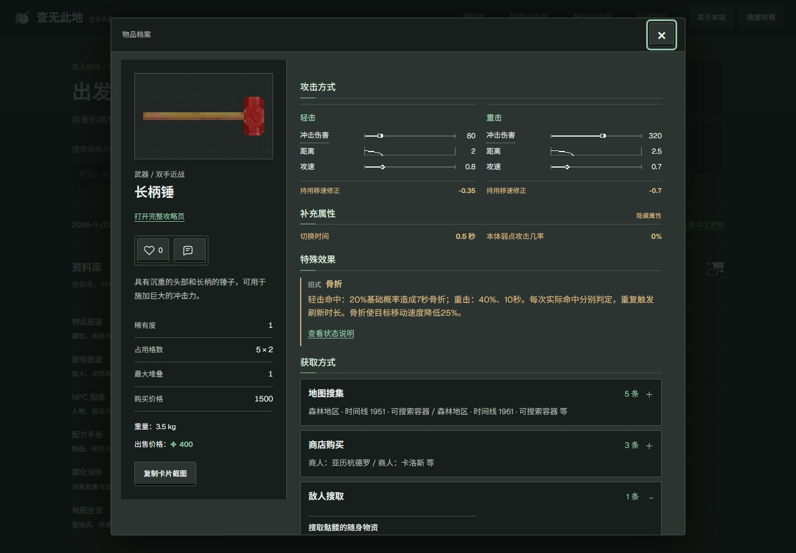
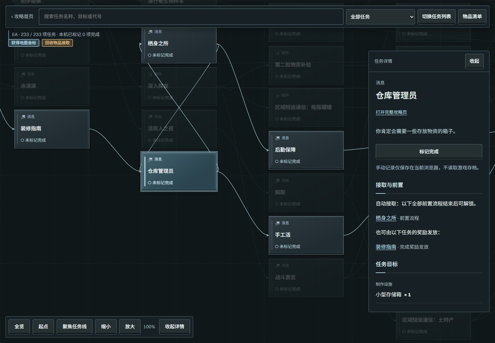
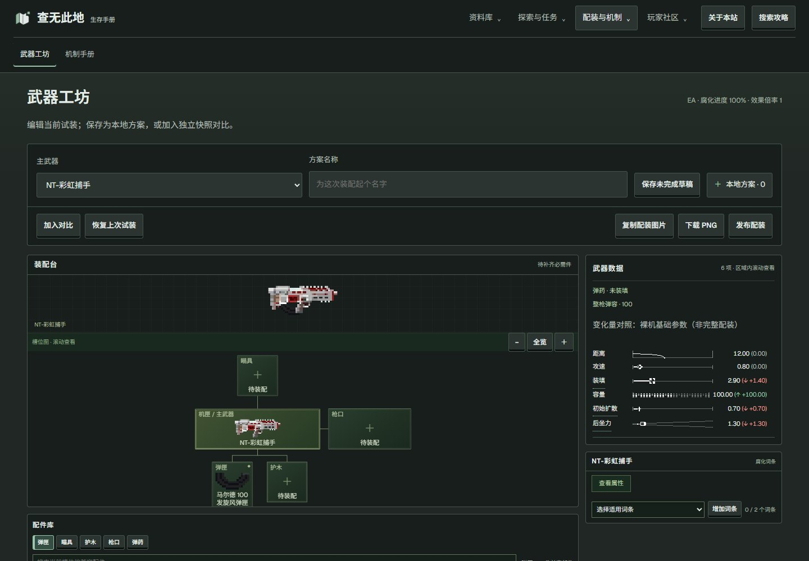
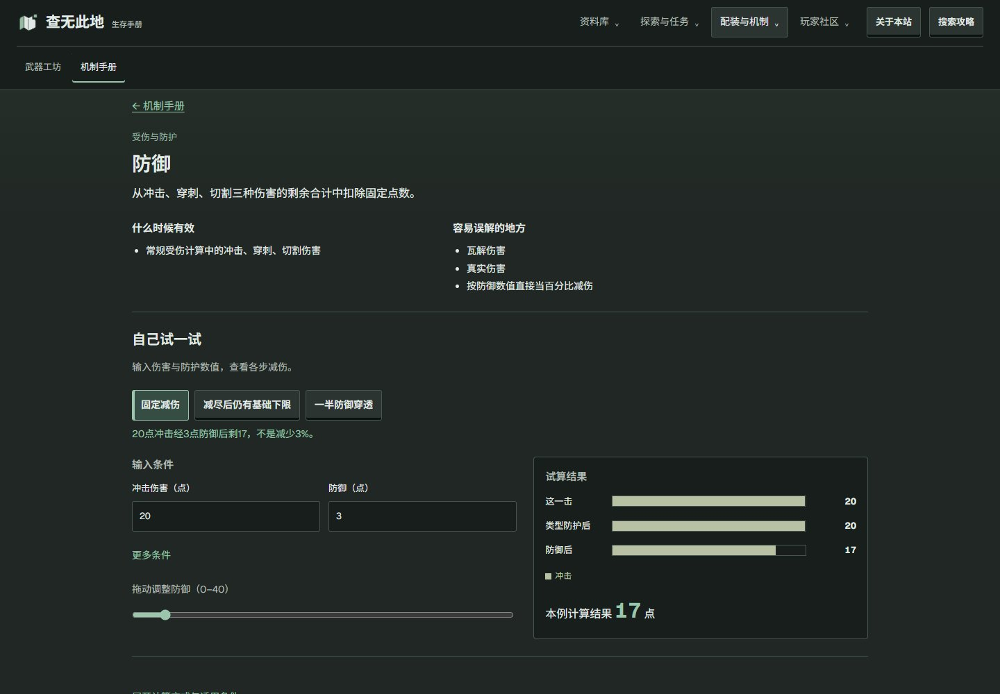

<div align="center">


# NSP Wiki · 查无此地生存手册

**出发之前，查清楚。**

面向《查无此地 / No Such Place》玩家的攻略与工具站。<br>
从装备属性、任务线索到地图路线与武器配装，把一次探索需要的信息放在一起。

[**进入 Wiki 主站 ↗**](https://nsp-wiki.shiaoming.cn/) · [浏览功能](#功能一览) · [本地预览](#快速开始) · [版本下载](https://github.com/Shiaoming123/nsp-wiki/releases) · [反馈问题](https://github.com/Shiaoming123/nsp-wiki/issues)

[](LICENSE)

</div>

[](https://nsp-wiki.shiaoming.cn/)

> 本仓库保存已发布 Wiki 的网站源码、玩家资料与完整静态资源。在线阅读直接访问主站，无需安装游戏插件。自有代码与原创内容采用非商业许可；本项目为玩家作品，非游戏官方项目。

## 功能一览

| 模块 | 可以做什么 | 在线入口 |
| --- | --- | --- |
| 物品与人物资料 | 查物品属性、使用效果和获取方式，关联敌怪、NPC、商店与配方 | [物品](https://nsp-wiki.shiaoming.cn/#items) · [敌怪](https://nsp-wiki.shiaoming.cn/#enemies) · [NPC](https://nsp-wiki.shiaoming.cn/#npcs) · [配方](https://nsp-wiki.shiaoming.cn/#recipes) |
| 任务攻略 | 在关系图中追踪任务前置、奖励与目标；手动记录进度、整理所需物品 | [任务关系图](https://nsp-wiki.shiaoming.cn/#quests) |
| 地图与探索 | 切换平面地图和三维实景，筛选资源点、查看容器物资，阅读办公室楼层及交通关系 | [地图全览](https://nsp-wiki.shiaoming.cn/#maps) · [容器与搜刮](https://nsp-wiki.shiaoming.cn/#loot) |
| 武器工坊 | 按插槽与兼容规则试装配件、查看参数变化、保存和比较方案，导出配装图片 | [进入工坊](https://nsp-wiki.shiaoming.cn/#workshop) |
| 机制手册 | 阅读属性、伤害与防护说明；修改示例输入，观察试算结果与适用条件 | [机制与状态](https://nsp-wiki.shiaoming.cn/#mechanics) |
| 腐化与镜柜 | 查词条效果、适用装备和镜柜资料 | [腐化词条](https://nsp-wiki.shiaoming.cn/#corruption) · [迷失镜柜](https://nsp-wiki.shiaoming.cn/#mirror) |
| 玩家交流 | 制作物品评级榜，在主站分享帖子、配装与反馈，查看更新档案 | [夯拉榜](https://nsp-wiki.shiaoming.cn/#tiers) · [Wiki 反馈](https://nsp-wiki.shiaoming.cn/#feedback) · [更新档案](https://nsp-wiki.shiaoming.cn/#updates) |
| 社区管理 | 按授权管理内容、反馈、成员发言与公告；站主分配权限，操作留有记录 | [管理中心](https://nsp-wiki.shiaoming.cn/admin/)（需相应权限） |

反馈列表和详情显示处理进度，内部处理备注不公开。管理入口沿用站内账号；本地部署者需配套启用社区 API 和数据库迁移，单独打开静态页面不会获得管理权限。

### 地图：把地点、物资和路线连起来

办公室支持楼层总览与可拖动、缩放的平面画布。选择关注楼层后，可查看对应交通点与跨层路线；其他地图保留各自的平面、三维和资源筛选入口。

[](https://nsp-wiki.shiaoming.cn/#maps/Origin08_1999)

### 从资料查阅到方案推演

| 物品详情 | 任务关系图 |
| --- | --- |
| [](docs/images/item-details.jpg) | [](docs/images/quest-graph.jpg) |
| 区分轻重击与不同攻击方式，将属性、效果和来源放在同一张档案里。 | 在任务上下文中查看条件与目标，手动标记的进度只保存在当前浏览器。 |

| 武器工坊 | 机制试算 |
| --- | --- |
| [](docs/images/weapon-workshop.jpg) | [](docs/images/mechanics.jpg) |
| 试装配件、核对兼容性和参数变化，再保存、比较或导出自己的方案。 | 用预设与可调整输入理解规则；示例明确计算条件，不冒充实机伤害结果。 |

图片可点击查看原尺寸。以上为 `20261103-office-plan-canvas` 版本的真实界面，拍摄于 2026-11-03；使用干净的本地浏览器和静态攻略资源，未使用真实账号或玩家社区内容。[截图版本记录](docs/images/screenshots.json)

## 快速开始

### 在线使用

打开 **[nsp-wiki.shiaoming.cn](https://nsp-wiki.shiaoming.cn/)** 即可查阅攻略。任务记录、评级草稿和本地配装方案保存在当前浏览器；登录、发帖及评论等社区功能由主站后端提供。

### 本地预览静态攻略

需要 **Git** 和 **Python 3.13**（已验证的预览环境）。也可以从 [Releases](https://github.com/Shiaoming123/nsp-wiki/releases) 下载归档，解压后从项目根目录执行最后一条命令。

```bash
git clone https://github.com/Shiaoming123/nsp-wiki.git
cd nsp-wiki
python -m http.server 8080 --bind 127.0.0.1 --directory public
```

浏览器访问 **[http://127.0.0.1:8080/](http://127.0.0.1:8080/)**。使用 HTTP 服务预览，不要直接双击 HTML 文件；页面需要通过请求读取资料和地图资源。

静态预览包含攻略、图片、地图和前端工具，不提供 `/api/` 服务。登录、帖子、评论、用户上传和在线统计需要另外配置后端，因此不能将本地预览当成完整社区服务。

## 开发与项目结构

网站以 JavaScript/CSS 和静态资料驱动交互，地图使用 Three.js。仓库同时保留 React/Next.js/Vinext 构建入口，以及独立社区服务和 SQL 结构；精确依赖以 [package-lock.json](package-lock.json) 为准。

```text
nsp-wiki/
├── public/                 # 前端代码、阅读页、资料、图片、地图与字体
│   ├── data/               # 玩家资料 JSON
│   ├── maps/               # 地图查看器、楼层导览与几何资源
│   └── fonts/              # 字体及原许可
├── app/                    # 页面与应用入口
├── lib/                    # 共享逻辑、导航与社区实现
├── db/                     # 数据库结构定义
├── drizzle/                # SQL 迁移与结构记录，不含业务数据
├── independent/            # 独立后端、存储适配与相关测试
├── scripts/                # 构建、打包及部分自检工具
├── docs/images/            # README 功能截图与拍摄记录
└── PUBLIC-EXPORT.json      # 对应发布身份及逐文件 SHA-256
```

<details>
<summary><strong>开发、重建与自检</strong></summary>

现有开发环境使用 **Node.js 24、Python 3.13**。仅阅读或静态预览不需要安装 npm 依赖。

```bash
# 按锁文件安装开发依赖
npm ci

# 本地框架开发入口
npm run dev

# 独立后端的隔离测试，不连接生产社区
node --test independent/analytics.test.mjs independent/analytics-http.test.mjs independent/server-traffic.test.mjs
```

阅读页由 `scripts/build-seo.cjs` 生成。重建阅读页还需要可用的 Playwright 和浏览器：通过 `PLAYWRIGHT_MODULE` 指定模块路径，`EDGE_PATH` 指定浏览器可执行文件，再运行 `node scripts/build-seo.cjs`。修改前端源码后，使用既有生成器更新内容指纹和引用，不要直接修改 `wiki-ui.*` 等生成文件。

框架构建入口为 `node scripts/run-framework.mjs build`。`npm run build` 额外执行面向 Sites 的资源后处理与预算检查，不等同于独立主站部署命令。后端打包入口见 [scripts/package-workshop-api.mjs](scripts/package-workshop-api.mjs)；服务配置、凭据和生产数据库不随仓提供。本 README 的界面与静态预览已验证，本次文档更新未重新安装依赖或执行完整框架构建。

</details>

## 数据说明与仓库边界

- 各资料模块保留自身版本、适用条件和未知状态。理论生成率与配置值不等于游戏实测掉率，也不代表所有模块已核验到同一游戏版本。
- 页面不读取或修改游戏存档。任务标记、准备量和配装记录是网页侧工具，不会代替游戏内操作。
- 本仓库包含 Wiki 使用的静态图片、地图几何、攻略阅读页和玩家资料；地图压缩资源保留原字节，不重新序列化几何数值。
- 公开资料移除了内部证据标识和本地来源路径；个人 Playwright 安装路径替换为通用模块名。
- 游戏本体、程序集、原始资源表、反编译源码、内部 Git 历史、私人维护记录、密钥、账号、数据库及玩家上传内容不在仓库中。

## 更新与版本留档

| 入口 | 用途 |
| --- | --- |
| [主站更新档案](https://nsp-wiki.shiaoming.cn/#updates) | 阅读面向玩家的功能和资料变更 |
| [GitHub Releases](https://github.com/Shiaoming123/nsp-wiki/releases) | 下载已归档版本及整包 `SHA256SUMS.txt` |
| [PUBLIC-EXPORT.json](PUBLIC-EXPORT.json) | 核对当前快照的 `release`、源提交和逐文件 SHA-256 |
| [提交记录](https://github.com/Shiaoming123/nsp-wiki/commits/main/) | 查看公开快照与仓库文档的演进 |

维护端每小时检查正式站点。只有线上版本与已完成发布的验收记录一致时，才生成公开快照、提交推送并建立版本归档；没有新版本不创建提交。新增文件先审阅公开范围，扫描失败或远端分歧时停止，不强推。

该同步依赖维护电脑上的 Codex、GitHub 登录和网络，不是 GitHub Actions。推送仓库不会部署主站或更改数据库。README 和展示图片可单独更新；历史 Release 保留当时的快照，不覆盖旧标签或附件。

## 反馈与参与

资料纠错、界面问题和功能建议可通过 **[GitHub Issues](https://github.com/Shiaoming123/nsp-wiki/issues)** 或 **[主站 Wiki 反馈](https://nsp-wiki.shiaoming.cn/#feedback)** 提交。建议附上相关条目链接、游戏版本、预期与实际情况；截图请遮去账号和其他私人信息。

本仓库由已发布源码导出。代码建议可通过 Pull Request 讨论，主站采用与发布需由维护者核验；不要提交游戏本体、原始资源包、存档、密钥或玩家数据。

## 许可与致谢

自有代码与自有原创内容采用 **[PolyForm Noncommercial 1.0.0](LICENSE)**：允许符合许可的非商业使用、修改和再分发，商业用途需另行获得许可。这是限制商业使用的源码可见许可，不是 OSI 开源许可。

《查无此地 / No Such Place》的名称、描述、设定、图像及其他游戏内容属于原权利人。本仓库不转授游戏素材权利。Three.js、html2canvas、Markdown 依赖、Noto Sans SC、Geist 等第三方内容保留各自许可，详见 **[NOTICE.md](NOTICE.md)**。

感谢游戏开发者，以及提供攻略、纠错和使用反馈的玩家。
